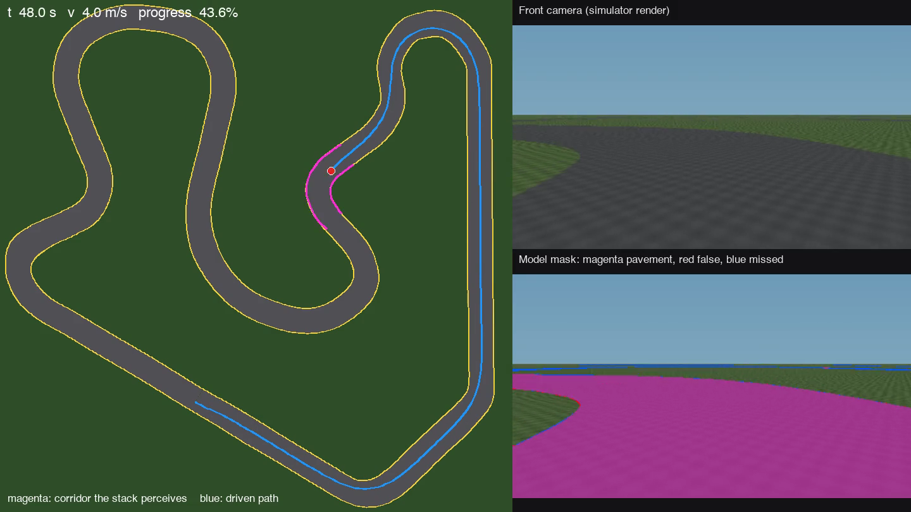
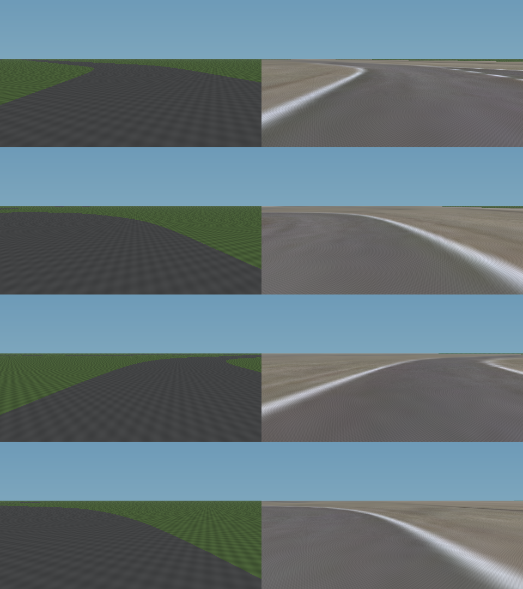
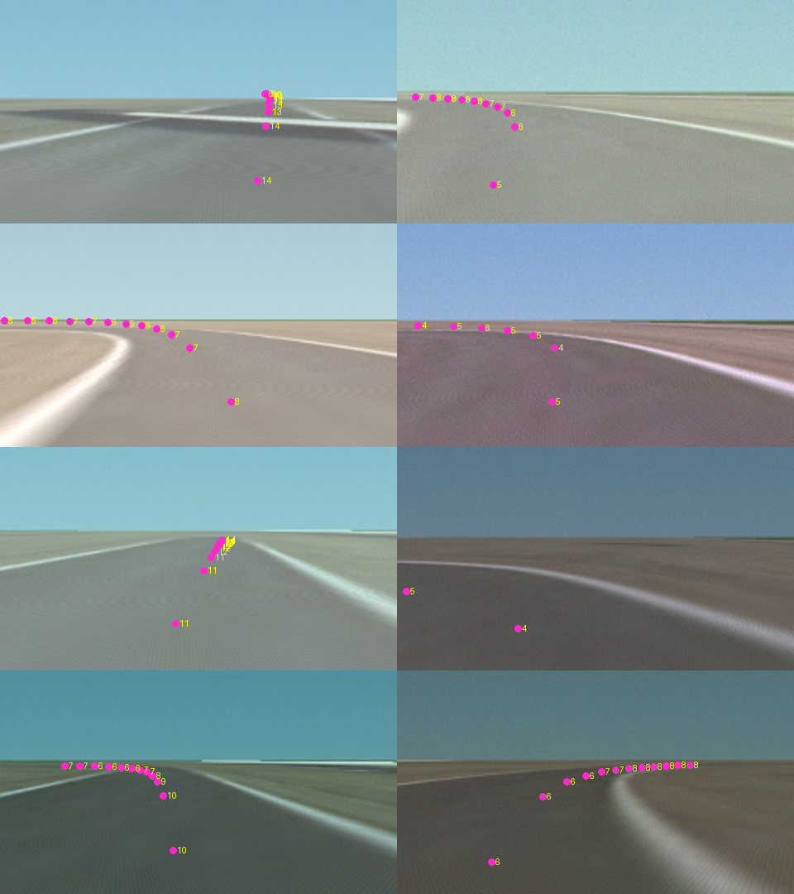
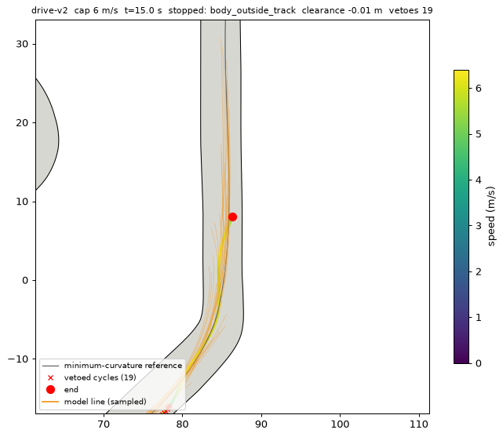
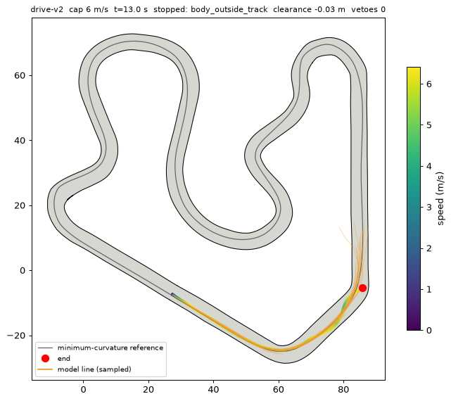

# Driving model: version log

A running record of each model we trained to drive the Purdue Grand Prix track from a camera, what changed, and what it measurably did. Screenshots are in `docs/img/driving-model/`. Everything here is simulator evidence; no version has seen a real camera image or driven a real kart. See [what this does not show](#what-this-does-not-show).

The rules every version is held to:

* **The model sees pixels only.** Its input is one RGB frame. It never reads the map, the track file, the GPS position, or any label. Only the outputs below leave the model.
* **The stack may use what a real kart has**: the estimated pose (GNSS and IMU), wheel speeds and the steering encoder. Not the map and not the true pose.
* **Expert labels are for training only.** They come from the map, and they never reach the model at run time. Benchmarks that use privileged information (a perfect line, the true corridor) are marked as upper bounds, never as model results.

## The pipeline

```
camera RGB --> model --> pavement mask  --> corridor tracker --> safety filter --> controllers --> kart
                    \-> racing line + speed ----------------------^
```

The model outputs a **pavement mask** and a **racing line** (12 waypoints, 2 to 24 m ahead, in the kart's frame) with a **target speed** at each. It does not output steering or throttle. The controllers (pure pursuit, a speed controller and, on this path, a closed loop on the steering encoder) turn the line into commands from *measured* state every 10 ms, so a servo that does not land exactly where it is told is corrected by feedback and not baked into the model.

The pavement mask feeds the **corridor tracker** (`CorridorTracker`, `src/mcq_sim/mcq_sim/perception.py`): it projects the mask to a top-down grid, remembers pavement seen in the last three seconds (placed with the *estimated* pose), and walks the corridor to get the left and right edges. The **safety filter** (`_model_trajectory`, `src/mcq_sim/mcq_sim/stack.py`) pulls the model's line back inside that perceived corridor, refuses a line that is grossly outside it, and caps speed so the kart can stop within the pavement it has actually seen.

## Versions

### v0 / v1: synthetic segmenter (2026-09-29 and 2026-10-06)



A 1.6 M-parameter encoder-decoder that outputs only a pavement mask, trained on frames from procedurally generated random tracks with randomized appearance. v1 is the full 12-epoch run (validation IoU 0.968 on tracks never trained on). With the corridor tracker it drove full Purdue laps on the **flat** simulator camera (106 s at 4 m/s, 0.46 m clearance, three seeds) and 6 m/s (74.7 s). On the **orthophoto-draped** camera it fell apart (IoU 0.93, stopped after 7 m): the training appearance was a guess, and a real-looking road broke it. That gap is the reason for everything after this.

### The camera drape (2026-10-06)



The simulator camera now drapes the real 2023 Indiana orthophoto over the ground plane (`TrackCamera(appearance="aerial")`), so the kart sees the track's actual asphalt, patches, white edge lines and surroundings. It is still a flat ground with no buildings, no curbs with height and the lighting of one day, so it is a harder and more honest test, not a photograph.

### drive-v1: first driving model (2026-10-06)



The same encoder-decoder plus a driving head that reads the 1/16-resolution bottleneck and outputs the line and speed. Trained by imitation on 24,000 draped frames, with poses sampled around the minimum-curvature racing line, camera mount and image appearance jittered. Epoch 7 of 10 (stopped early): racing-line error 0.50 m near (2 to 10 m ahead), 1.69 m far (12 to 24 m), speed error 1.14 m/s, mask IoU 0.969. A model that ignores the image and always predicts the average line scores 1.34 m near and 6.78 m far, so it learned the road, but near-line error is where steering is decided and 0.5 m is a lot on a 5 m pavement. In the closed loop it drove 163 m and then clipped the inside of the hairpin exit.

### drive-v2: finer driving head, corner-weighted data (2026-10-18)




The driving head also reads the quarter-resolution decoder features with pixel-coordinate channels (the near-line error is a matter of a few pixels that the coarse bottleneck blurs), and training poses are drawn up to three times as often in corners. 12 epochs, 32,000 frames. Open-loop on frames never trained on: **0.35 m near, 0.74 m far, 0.57 m/s speed error, mask IoU 0.974**, against 0.50 / 1.69 / 1.14 for drive-v1.

Closed loop was a different story, and it is why the next two entries exist. Without correction the kart drifted across the long straight and touched the right edge at about 70 to 83 m (first image). The remedy was the safety filter above: with it, the kart clears the first corner and the straight (second image), and drive-v2 **completes the full lap at 4 m/s (106.8 s)**, including with 5x GPS noise, a 10 s GPS outage and float-only GPS, so GPS quality barely matters to it. Above that it still fails around the first corner exit.

### drive-v3: DAgger recovery data (2026-10-18)

drive-v2 initialized, then trained on fresh frames plus 12,356 frames collected by DAgger: the model drives the full stack in the simulator (with random steering bumps so it wanders off its line), and the expert labels every frame with what it should have done *from where the kart actually is*. That teaches recovery from states imitation never visits. 10 epochs. Open-loop: **0.29 m near, 0.62 m far, 0.42 m/s speed error, mask IoU 0.978**, the best of the three.

Closed loop, camera only, full stack, two seeds (`training/perception/race_eval.py`):

| Speed cap | drive-v2 lap / closest edge | drive-v3 lap / closest edge |
| --- | --- | --- |
| 4 m/s | 106.7 s / 0.22 m | 107.1 s / 0.39 m |
| 6 m/s | 73.8 s / 0.35 m | 74.1 s / 0.38 m |
| 8 m/s | 64.3 s / 0.25 m | 63.8 s / 0.31 m |
| 10 m/s | one seed fails at 55 m | 63.8 s / 0.34 m |

drive-v3 clears every cap on both seeds, with about 0.1 m more room to the edge than drive-v2. The lap time levels off near 64 s from 8 m/s: the model's speed requests (taught by an expert tuned to a conservative 3 m/s^2) and the stack's sight limit set the pace, not the cap. For reference the map-driven expert only clears 6 m/s (73.6 s). These laps are what the safety filter, the speed-within-sight limit and the held-last-line rule bought: the same drive-v2 stopped at about 70 m at 6 m/s before them.

### drive-v4 and drive-v5: real footage for the pavement mask (2026-10-18 and 19)

A simulator-only model does not transfer. Scored against auto-labels on 1,248 real kart onboard frames from 16 videos (`training/perception/real_eval.py`), **drive-v3's pavement mask reaches 0.39 IoU, below the 0.47 of a fixed "the lower part of the picture is road" guess.** drive-v4 starts from drive-v3 and adds real frames to every batch, teaching the pavement mask only (real frames carry no racing line). With 969 helmet-cam frames it reaches **0.72 IoU** on three held-out videos. drive-v5 adds 26 nose and bumper-cam clips (about 2,000 usable auto-labeled frames from 16 good clips; 10 clips whose labels failed, mostly indoor tracks, were left out) and scores **0.84 IoU on 575 held-out real frames** from six videos it never trained on, including three nose-cam clips from different venues. Simulator metrics barely moved (0.27 m near, 0.54 m far, 0.34 m/s). The labels are SegFormer pseudo-labels with no human review, and the held-out clips are still other people's cameras on other tracks, so this is a large real improvement and not proof for the kart's own camera.

Closed loop, default limits, no speed cap, three seeds: **drive-v5 laps in 64.6 s with 0.39 m to the edge**, drive-v4 in 64.3 s (0.40 m) and drive-v3 in 63.8 s (0.35 m). drive-v5 is the model the demo opens with.

### drive-v6: the faster teacher (2026-10-19): trains well, does not yet drive

drive-v5 initialized, then trained to reproduce the 54.65 s line the second lap-time search found (labels from that expert, 15,503 recovery frames collected with a sloppy kart and the faster limits, plus the real footage). Open loop it is the best yet (**0.22 m near, 0.49 m far, 0.27 m/s, mask 0.982, real-footage IoU 0.84**), but those numbers are scored against a different, faster teacher and do not compare with v5's. **In the closed loop it fails**: it leaves the track at the same stretch (about 174 m) on every set of limits tried, and at about 47 m under the faster limits. So it cannot be shown or used. The line itself is realizable (the camera pipeline laps it in 55.4 s given a perfect mask), so the gap is the model's fidelity at that stretch. The next step is more recovery data concentrated there. drive-v5 and the faster-limits models also fail under the faster limits (drive-v3 through v5 only complete laps at the default limits), which is why the demo leaves "faster limits" off.

### Lap-time optimization (2026-10-18 and 19)

Imitation cannot beat its teacher, so `training/perception/laptime_opt.py` searches for a faster expert by scoring candidate racing lines and speed profiles on their simulated lap time (CMA-ES, 43 parameters). The first run settled on laps of 57.55 s (normal kart) and 58.60 s (sloppy kart) on pavement 0.25 m narrower than the track file, but the line was fragile: on the real-width pavement it failed at 168 m even with a perfect corridor, because the search had learned to lean on the safety filter. The second run penalizes lines the filter has to correct and also scores a lap on the real-width pavement. Its best (103 generations) laps in **54.65 s on the normal kart, 55.30 s on the sloppy kart and servo, and 54.65 s on the real-width pavement with 0.50 m to the edge and no filter corrections**, using moderate limits (4.5 m/s^2 cornering, 1.8 acceleration, 2.0 braking) and a top speed of 12.5 m/s. This is the privileged, offline teacher; the camera pipeline realizes it in 55.4 s with a perfect mask.

## Robustness work

* **Camera and track mismatch.** `training/perception/robustness.py` drives the same lap with the pavement wider or narrower than the track file, the camera mount off by a few degrees or centimetres (the model keeps the nominal calibration, as on an uncalibrated kart), a darker, brighter, noisy or blurred image, and worse GPS. Results are recorded here as they come in.
* **A steering servo that does not land where it is told.** `src/mcq_sim/mcq_sim/actuators.py` models gain error, offset, dead zone (backlash) and jitter. Tested on the optimized expert's line: an uncorrected 1 degree dead zone crashed the lap at 21 m. Closing a P+I loop on the steering encoder around the servo (gains 1.5 and 6) laps it at the normal 59.2 s with 0.37 m clearance, and also laps with gain, offset and jitter errors together. A 2 degree dead zone is still too much. The loop is used on the model's path only; the older planner paths keep their open-loop steering.
* **Weaker grip and brakes.** Lower grip (0.8) alone made the kart leave the track at launch, because the stack asked for hard acceleration into the first bend. The optimizer scores this world too, so the speed profile it learns respects it.

## What this does not show

* Nothing here has touched a real camera image. The real mount, lens, exposure, shadows, the real pavement's surface and the track's surroundings will differ. Real footage is the acceptance test (docs/08 section 7).
* The track file is hand-traced from aerial imagery and the tyres, brakes and servo are placeholders. The sim says a 59 s lap is feasible; it does not say what the real kart will do.
* The driving path exists only in the Python simulator. It is not ported to the kart's ROS 2 stack, not exported for the Jetson, and not timed against the 20 fps budget.
* The first real-world step should be shadow mode: a human drives on the RC with the camera logging, the model predicts without touching the actuators, and its line is compared with what the human drove and the surveyed edges. Then the speed ladder in docs/04.
